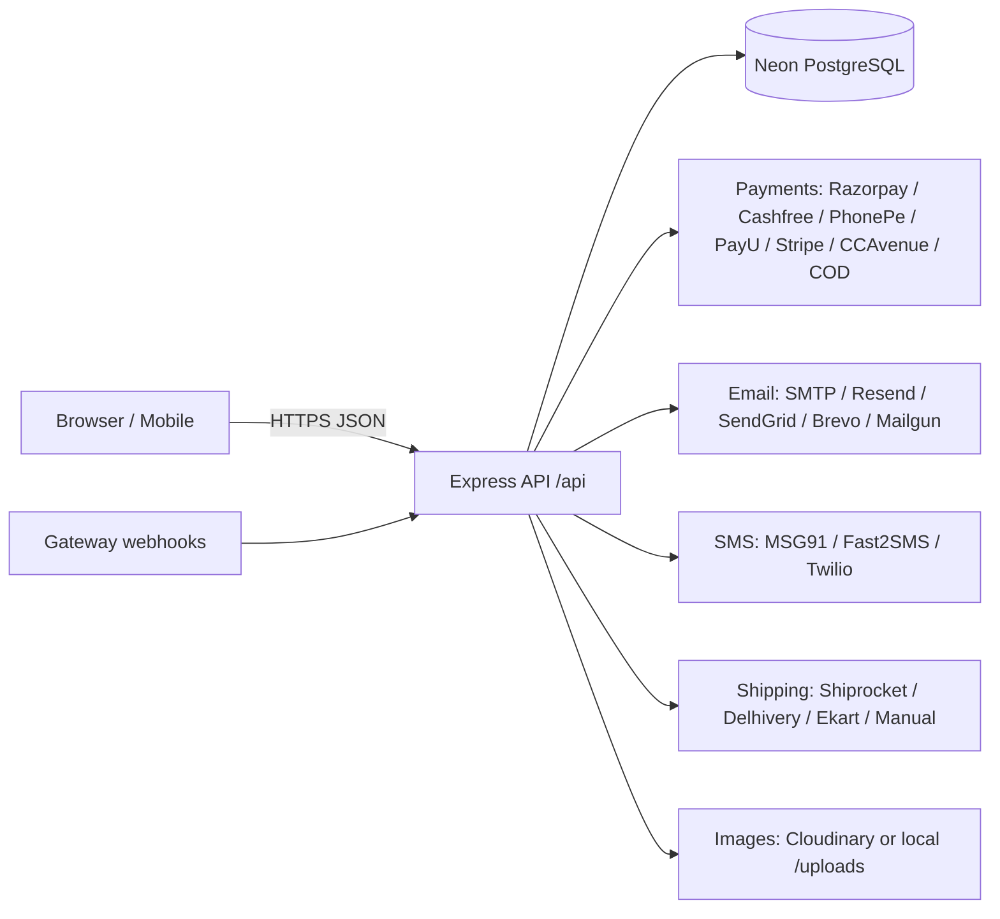

# Easy Life Care — E-Commerce Platform: CTO Plan

## 1. Goal
A production-ready, Amazon-style e-commerce platform for an Indian D2C brand. Everything is
data-driven (DB + env). Every third-party integration (payment, email, SMS, shipping, storage)
is pluggable: drop the keys into `server/.env` and the provider activates automatically.
Multiple providers per category can be configured at once, with automatic fallback.

## 2. Architecture

```
client/  React 19 + Vite + TypeScript + Tailwind v4 + TanStack Query + Zustand + Recharts
server/  Node + Express 5 + TypeScript + Prisma ORM + PostgreSQL (NeonDB) + Zod
```



### Server layout (`server/src`)
| Folder | Responsibility |
|---|---|
| `config/` | Zod-validated env. Unconfigured providers are disabled, never crash the app |
| `lib/` | prisma, logger, errors, http client, money, crypto helpers |
| `middleware/` | auth (JWT + RBAC), error handler, rate limits, upload validation |
| `modules/auth` | register, login, refresh rotation, logout, email/phone OTP, password reset |
| `modules/catalog` | products, categories, brands, filters, search suggestions, similar products |
| `modules/customer` | profile, addresses, cart, wishlist, reviews |
| `modules/orders` | checkout pricing, order placement, stock reservation, cancel/return, invoice |
| `modules/payments` | provider adapters + verify + webhooks + refunds |
| `modules/shipping` | provider adapters + serviceability + shipment creation + tracking sync |
| `modules/notifications` | email + SMS adapters with fallback chain, templates, delivery log |
| `modules/admin` | dashboard analytics, CRUD for every entity, settings, staff |
| `modules/cms` | public settings, banners, CMS pages, FAQs, contact, newsletter |
| `jobs/` | expire unpaid orders + restock; shipment tracking sync |

### Provider pattern
Every integration implements one interface (`PaymentProvider`, `ShippingProvider`,
`EmailProvider`, `SmsProvider`) with `isConfigured()`. The registry exposes only configured
providers. Admins can additionally switch providers off from **Settings**.
Email/SMS use an ordered fallback chain (`EMAIL_PROVIDER_ORDER`, `SMS_PROVIDER_ORDER`).

## 3. Data model (Prisma)
User, RefreshToken, OtpCode, Address, Category (tree), Brand, Product, ProductImage, Review,
CartItem, WishlistItem, Coupon, Partner, PartnerCommission, Order, OrderItem,
OrderStatusHistory, Payment, Shipment, Banner, Setting (key/value JSON), CmsPage, Faq,
ContactMessage, NewsletterSubscriber, NotificationLog, AuditLog.

Money is `Decimal(12,2)`, and prices are GST-inclusive (Indian B2C). Each order item snapshots
price, MRP, cost price and tax rate, so later product edits never change historical profit.

## 4. Business rules
- **Pricing is computed only on the server.** The client never sends a price.
- **Stock** is reserved atomically (`UPDATE ... WHERE stock >= qty`) at order placement.
  Unpaid online orders expire after `ORDER_PAYMENT_TIMEOUT_MINUTES` and stock is restored.
- **Payment finalisation is idempotent.** It runs from the client verify call, the webhook or the
  redirect callback, whichever arrives first.
- **Profit** = (Revenue − GST) − COGS − gateway fees − shipping cost − partner commission.
- **Partner (affiliate) commission**: a `?ref=CODE` link is stored on the client for 30 days and
  attached to the order. Commission moves PENDING → APPROVED (delivered) → PAID (admin), or
  becomes CANCELLED.
- **GST invoice**: CGST+SGST when the customer's state equals the store's state, else IGST.
- **COD**: toggle, extra fee and maximum order value come from settings.

## 5. Security checklist
Helmet, strict CORS allow-list, rate limits (global + auth + OTP), bcrypt (12 rounds),
short-lived JWT access token in memory, rotating refresh token (hashed in DB, httpOnly cookie,
custom-header CSRF guard), RBAC (CUSTOMER / ADMIN / SUPER_ADMIN), Zod validation on every input,
HMAC verification of every webhook, magic-byte image validation with size limits, no HTML rendering
of user content, audit log of admin actions, and no secrets in the client.

## 6. Work breakdown & status
| # | Workstream | Owner role | Status |
|---|---|---|---|
| 1 | Plan, schema, migrations, seed | Architect | Done |
| 2 | Server core: env, errors, auth, RBAC, security | Backend + Security | Done |
| 3 | Catalog, search, filters, reviews, similar products | Backend | Done |
| 4 | Cart, wishlist, addresses, coupons, checkout, orders, invoice | Backend | Done |
| 5 | Payments (7 providers + COD), webhooks, refunds | Backend + Security | Done |
| 6 | Shipping (Shiprocket, Delhivery, Ekart, Manual), tracking job | Backend | Done (Ekart direct: verify against merchant docs) |
| 7 | Email (5) + SMS (3) with fallback + logs | Backend | Done |
| 8 | Admin analytics (sales, profit, commission, charts) + CRUD | Backend | Done |
| 9 | Storefront UI (home, listing, PDP, cart, checkout, account) | UI/UX | Done |
| 10 | Admin dashboard UI | UI/UX | Done |
| 11 | Build verification (tsc + vite build) + 26-step E2E API test on Neon | QA | Done |
| 12 | Next phase: product variants, GST e-invoice, PWA, push notifications, multi-warehouse | Product | Backlog |

## 7. Running
See `server/README.md` and `client/README.md`. Short version:
```bash
cd server && cp .env.example .env   # fill DATABASE_URL (Neon) + any keys
npm install && npm run db:deploy && npm run db:seed && npm run dev
cd ../client && cp .env.example .env && npm install && npm run dev
```
Super admin credentials come from `SUPER_ADMIN_EMAIL` / `SUPER_ADMIN_PASSWORD` during seeding.
Change history is kept in `UPDATE.md`.
